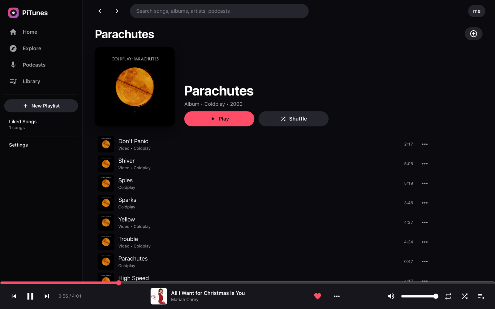

# PiTunes



Your own ad-free music and podcast player. A Raspberry Pi at home finds and
streams the audio and serves the app itself: open the Pi's address in a browser
on any phone, tablet or laptop, add it to your home screen, and play from
anywhere over [Tailscale](https://tailscale.com). Nothing runs in the cloud,
there is no account to create with us, and no Google login.

- **Music:** search, albums, artists, playlists, charts, moods, radio and
  autoplay, lyrics, likes, your own playlists, a speed dial of your most played songs.
- **Podcasts:** browse and search, subscribe, resume where you left off, playback speed.
- **Everywhere:** a phone layout and a desktop layout, offline downloads, lock
  screen, headphone and car controls, sleep timer, lyrics.
- **For a household:** each person gets their own profile, recognised by their
  Tailscale account. No passwords.
- **Small:** runs on a Raspberry Pi Zero 2 W (512 MB RAM). The server uses about 100 MB.

Full guide with pictures: <https://pitunes.com>

```
server/        Python server (FastAPI + yt-dlp + ytmusicapi)
server/src/pitunes/web/   The web app (plain HTML, CSS and JavaScript, no build step)
ios/           Optional native iPhone app in SwiftUI (adds CarPlay and sound search)
deploy/        Install script pieces and systemd units
site/          The pitunes.com website
docs/          Design notes and the original plan
```

> **Know what you're running.** The server plays audio from YouTube without
> signing in. Whether that is acceptable is between you, YouTube's terms of
> service and your local law. PiTunes is for personal use on your own network
> and is not affiliated with YouTube, Google or Apple.

---

## Set it up

You need a Raspberry Pi (Zero 2 W or better), a microSD card, a free Tailscale
account, and any phone, tablet or computer with a current browser.

### 1. Prepare the Pi

Flash **Raspberry Pi OS Lite (64-bit)** with
[Raspberry Pi Imager](https://www.raspberrypi.com/software/). In the Imager's
settings, set a hostname (this guide uses `music`), a username and password,
your Wi-Fi, and **enable SSH**. The Zero 2 W only supports 2.4 GHz Wi-Fi.

Put the card in the Pi, power it on, wait a few minutes, then from a computer
on the same Wi-Fi:

```sh
ssh <username>@music.local
```

### 2. Install Tailscale on the Pi

```sh
curl -fsSL https://tailscale.com/install.sh | sh
sudo tailscale up             # prints a login link; open it and approve
```

Install the Tailscale app on each device you'll listen on and sign in to the same account.
In the [Tailscale admin page](https://login.tailscale.com/admin/machines), open
the Pi's menu and choose **Disable key expiry**, so it doesn't drop off your
network in a few months.

Also switch on HTTPS, so the app can store songs for offline listening: in the
[DNS page](https://login.tailscale.com/admin/dns) of the admin console, scroll to
**HTTPS Certificates** and choose **Enable HTTPS**. (This lists the Pi's name,
like `music.your-tailnet.ts.net`, in a public certificate log; the Pi itself
stays reachable only from your tailnet.)

### 3. Install PiTunes on the Pi

```sh
curl -fsSL https://raw.githubusercontent.com/pf25/pitunes/main/install.sh | bash
```

This takes roughly 5 to 10 minutes on a Pi Zero 2 W. It installs what the
server needs, starts it, makes it start on every boot, and ends by printing the
address of your player. It asks for your Pi password once (sudo).

What it sets up:

- `pitunes.service`: starts on boot, listens **only** on the Pi's Tailscale address, restarts if it crashes
- `pitunes-update.timer`: every night, updates yt-dlp and Deno (YouTube changes often), and rolls back if the new version can't play a test song
- logs kept in RAM only, so logging never wears out the SD card
- automatic OS security updates; password SSH login is turned off once you have an SSH key installed

**Updating PiTunes later:** run the same install command again. Your library
and song cache in `~/pitunes/server/data/` are never touched.

### 4. Open the app

There is nothing to install from a store. With Tailscale connected, open the
address the installer printed (for example `https://music.your-tailnet.ts.net`)
in your browser, then add it to your home screen: on iPhone, Safari's Share
button and **Add to Home Screen**; on Android, the browser menu and **Install
app**. On a computer, just open the same address.

Without HTTPS the player is at `http://music:8000`; everything works there
except offline downloads.

### 5. Add your family

Invite each person to your tailnet (Tailscale admin page, **Users**, **Invite
external users**). They install Tailscale, open the same address, and pick or
create their profile once. From then on the server
recognises them by their Tailscale account.

---

## Looking after it

```sh
systemctl status pitunes                 # running?
journalctl -u pitunes -f                 # live logs
sudo systemctl start pitunes-update      # run the yt-dlp/Deno update now
systemctl list-timers pitunes-update.timer
```

**Backups:** the whole library (likes, playlists, history, podcasts) is one file,
`~/pitunes/server/data/pitunes.db`. `curl http://<pi-address>:8000/backup > pitunes.db`
saves a consistent copy from any computer on your tailnet.

**What the installer hardens:** the service runs sandboxed (no access to SSH
keys, read-only system folders), and the nightly update runs as your user, not root.

### If you flashed the desktop image by mistake

The full (desktop) Raspberry Pi OS uses far too much RAM on the Zero. Check with
`systemctl get-default`: if it says `graphical.target`, convert it.

```sh
sudo cp /boot/firmware/config.txt /boot/firmware/config.txt.bak-desktop
sudo systemctl set-default multi-user.target          # boot to console, no desktop
sudo systemctl disable lightdm bluetooth udisks2 accounts-daemon \
     rpcbind.service rpcbind.socket nfs-blkmap cups cups-browsed colord
sudo systemctl mask packagekit
systemctl --user mask pipewire.socket pipewire-pulse.socket wireplumber.service
# In /boot/firmware/config.txt: comment out dtoverlay=vc4-kms-v3d,
# max_framebuffers=2, display_auto_detect=1, camera_auto_detect=1, then add:
#   gpu_mem=16
sudo reboot
```

Result: 415 → 462 MB usable RAM, idle use ~165 MB, swap no longer used at idle.


---

## Troubleshooting

- **HTTP 502 "could not resolve audio" / "Sign in to confirm you're not a bot"**:
  YouTube changed something. On the Pi: `sudo systemctl start pitunes-update` (or run the install command again).
  On the Mac: `cd server && uv sync --upgrade-package yt-dlp --upgrade-package yt-dlp-ejs`.
- **`No supported JavaScript runtime`**: Deno isn't on `PATH`. Check `deno --version`.
- **Warning about `VIRTUAL_ENV ... does not match`**: another project's venv is
  active in your shell. It's harmless. Run `deactivate` to silence it.

---

## The native iPhone app (optional)

`ios/` holds a native SwiftUI app with the same features plus a CarPlay screen,
"identify a song playing nearby", and podcast downloads. It isn't on the App
Store; build it yourself with Xcode ([ios/README.md](ios/README.md)).

## Questions and bugs

Open an [issue](https://github.com/pf25/pitunes/issues). That's the only support channel.

---

## Development

### Run the server on your computer

```sh
brew install uv deno          # deno: yt-dlp uses it to solve YouTube's JS challenges
cd server
uv sync                       # creates server/.venv and installs dependencies
uv run pitunes                # serves on http://127.0.0.1:8000
```

Then:

- **Browser:** open <http://127.0.0.1:8000/> for the web app.
- **VLC:** *File → Open Network…* and paste `http://127.0.0.1:8000/stream/<video_id>`.
  `/search` results include a ready-made `stream_url`.
- **curl:**
  ```sh
  curl 'http://127.0.0.1:8000/search?q=daft+punk+get+lucky&limit=5'
  curl -o song.m4a http://127.0.0.1:8000/stream/5NV6Rdv1a3I
  curl http://127.0.0.1:8000/health       # memory usage
  ```

The **first** play of a song takes about 8 s: around 3 s for yt-dlp to resolve it,
then about 5 s because YouTube's URL only starts working a few seconds after it's issued.
After that the song is on disk, so replays are instant. The test page also
prefetches the next song in the results list while one plays, so moving down
the list is instant too.


To push your working copy to the Pi instead of installing from GitHub:

```sh
./deploy/deploy.sh                 # tries <you>@music, then <you>@music.local
PITUNES_PI=pi@mybox ./deploy/deploy.sh
```

Each deploy first saves the library to `~/pitunes-backups/` on your computer
(`./deploy/backup.sh` does it on demand).

**Tests:** `cd server && uv run pytest`. The iPhone app has UI tests; see [ios/README.md](ios/README.md).


| Method | Path | What it does |
|---|---|---|
| GET | `/` | The web app (files in `server/src/pitunes/web/`) |
| GET | `/health` | `{"ok": true, "memory": {...}}` (peak RSS for server and Deno) |
| GET | `/search?q=&limit=10` | Search YouTube; returns id, title, artist, duration, thumbnail, stream_url |
| GET | `/resolve/{id}` | Debug: what yt-dlp resolved (bitrate, size, URL expiry) |
| GET, HEAD | `/stream/{id}` | The audio (AAC in m4a, `audio/mp4`), with HTTP Range support for seeking. Served from the disk cache when available; otherwise downloaded into the cache while streaming |
| POST | `/prefetch/{id}` | Download a song into the cache in the background (returns at once) |
| GET | `/cache` | Cache size, song count, downloads in progress |
| GET | `/radio/{id}` | Similar songs (YouTube's Mix) |
| GET | `/music/...` | YouTube Music browsing: home, explore, charts, moods, search, artist, album, playlist, lyrics |
| GET | `/img?u=` | Artwork proxy (YouTube image hosts only), cached on disk |
| GET | `/backup` | Snapshot of the library database |
| * | `/likes`, `/playlists`, `/plays`, `/history`, `/profiles` | Library (see `library_api.py`) |

### Settings (environment variables)

| Variable | Default | Meaning |
|---|---|---|
| `PITUNES_HOST` | `127.0.0.1` | Bind address (`--host` overrides it) |
| `PITUNES_PORT` | `8000` | Port (`--port` overrides it) |
| `PITUNES_MAX_RESOLVES` | `1` | Concurrent yt-dlp resolves (each can use around 300 MB for Deno) |
| `PITUNES_CHUNK_BYTES` | `10485760` | Upstream fetch chunk size |
| `PITUNES_DATA_DIR` | `server/data` | Song cache lives in `<dir>/cache/` |
| `PITUNES_CACHE_MAX_GB` | `4` | Cache cap; least recently played songs are deleted beyond it (~1,000 songs at 4 GB) |
| `PITUNES_MIN_FREE_GB` | `2` | Below this much free disk, songs are streamed without caching |
| `PITUNES_ALLOWED_HOSTS` | `music,music.local` | Extra hostnames the server answers to. The Pi's own name, `<name>.local`, `*.ts.net` and IP addresses always work |


---

## Licence

Copyright (C) 2026 the PiTunes authors.

PiTunes is free software: you can redistribute it and/or modify it under the
terms of the GNU General Public License as published by the Free Software
Foundation, either version 3 of the License, or (at your option) any later
version. It is distributed in the hope that it will be useful, but WITHOUT ANY
WARRANTY. See [LICENSE](LICENSE) for the full text.

PiTunes is not affiliated with, endorsed by or sponsored by YouTube, Google or
Apple. Raspberry Pi is a trademark of Raspberry Pi Ltd. Tailscale is a trademark
of Tailscale Inc.
